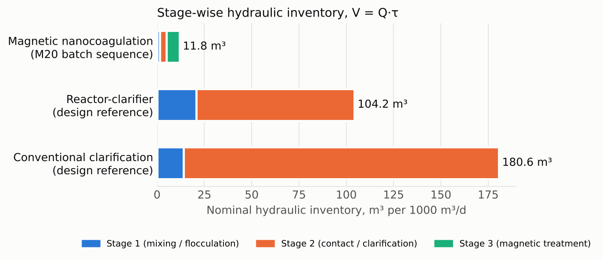
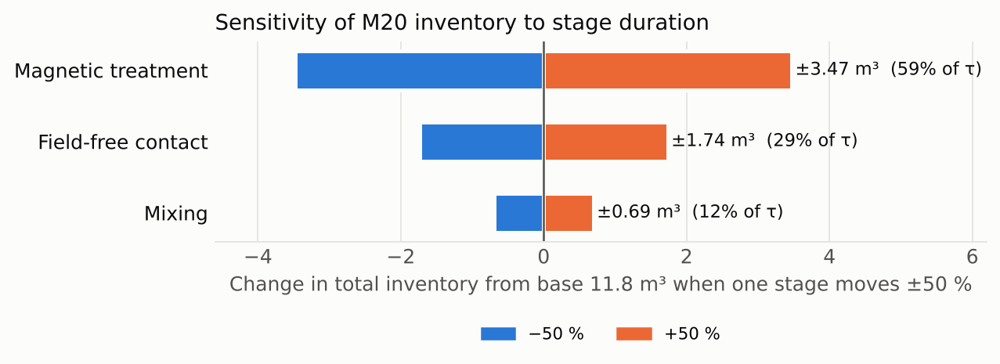

# Case study A — Hydraulic inventory calculator for post-precipitation separation

A small, checkable engineering tool built around one question: **how much tank
volume does a separation sequence need per unit of treated flow, and how does a
new sequence compare with conventional chemical clarification?**

The core calculation reproduces the prospective hydraulic-intensity analysis in
my first-author manuscript on magnetic nanocoagulation for CaF₂ separation in
semiconductor wastewater (under review, *Journal of Environmental Chemical
Engineering*). The extensions (footprint, nanocoagulant make-up, sensitivity)
are parametric and use user-supplied assumptions. No client or plant data are
used anywhere.

## Two implementations, one set of test vectors

| | Path | Purpose |
|---|---|---|
| Python | `python/hydraulic_inventory.py` | Reference implementation, typed, documented, unit-tested |
| Web | `web/index.html` | Single-file interactive calculator (no build, no dependencies) |
| Shared | `shared/test_vectors.json` | Expected values both implementations must reproduce |

The expected values for the manuscript case come from the published Fig. 5
source data (`Fig5_Hydraulic.csv`) and the manuscript text, not from either
implementation. Both the pytest suite and the page's on-load self-check compare
against them to 1e-9 m³.

```
cd python
python -m pytest -q          # 11 tests
python make_figures.py       # regenerates figures/
python hydraulic_inventory.py   # JSON dump of the 1000 m³/d case
```

## Formulas

| Quantity | Formula | Notes |
|---|---|---|
| Equivalent process time | τ_eq = Σ τ_i | stages treated as sequential and additive |
| Nominal HRT | τ_HRT,nom = τ_eq | equivalent-performance continuous-flow assumption |
| Stage inventory | V_i = Q · τ_i / 1440 | Q in m³/d, τ in min |
| Total inventory | V = Q · τ_eq / 1440 | |
| Ratio | V_ref / V_candidate | |
| Plan area (extension) | A = V / depth | ignores freeboard, walls, hydraulics |
| Make-up (extension) | gross = dose · Q / 1000; make-up = gross · (1 − reuse) | kg/d; reuse fraction is an assumption |

At Q = 1000 m³/d, the demonstrated 2 + 5 + 10 min sequence gives 11.81 m³
(1.39 + 3.47 + 6.94). The two design references from Virginia Administrative
Code 9VAC25-790-850 — reactor-clarifier 30 + 120 min and separate
flocculation + settling 20 + 240 min — give 104.2 and 180.6 m³, i.e. 8.8× and
15.3× the candidate.



Because V is linear in each τ_i, the one-at-a-time sensitivity is exact and
simply reports each stage's share of τ_eq; the magnetic-treatment stage carries
59 % of the candidate inventory.



## Input validation

Both implementations reject and warn on the same conditions, driven by the
shared vectors:

- **Errors** (no result): missing or non-numeric flow, non-positive flow,
  negative stage duration, zero candidate inventory (ratio undefined),
  non-positive depth, reuse fraction outside 0–1.
- **Warnings** (result shown, flagged): flow > 10⁶ m³/d (likely unit error),
  any stage > 24 h (likely seconds entered as minutes), total HRT > 12 h
  (outside screening range), zero-duration stage.

## Boundary and limitations

- Separation stage only. Calcium precipitation and ageing upstream are excluded.
- "Equivalent performance at the same nominal HRT" is an assumption for
  screening; it is not a claim that a continuous reactor would achieve the batch
  result. Actual design needs residence-time distribution, field geometry and
  solids handling.
- The design-reference durations are regulatory design minima for chemical
  clarification, used for context; real plants vary.
- Reuse fraction is not the same quantity as the manuscript's "65.9 % of
  initial inventory entering Cycle 3"; enter your own value.

## AI use

Layout, script scaffolding and this README were drafted with AI assistance
(Claude). Formulas are written out above; the test vectors were recorded from
the manuscript source data independently of either implementation, and both
implementations are checked against them automatically.

## Licence

MIT for the code. The manuscript figures and data remain under their own terms.
