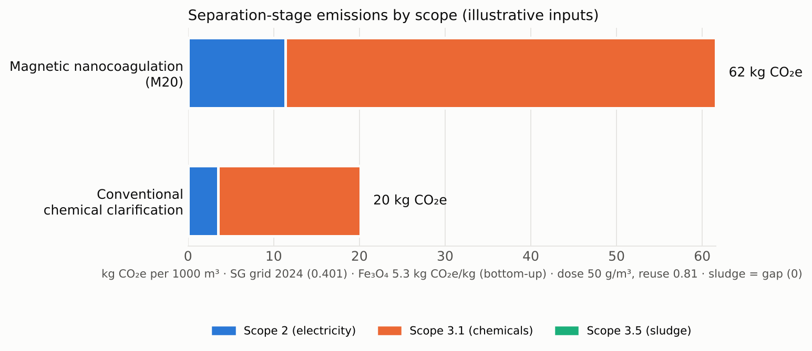
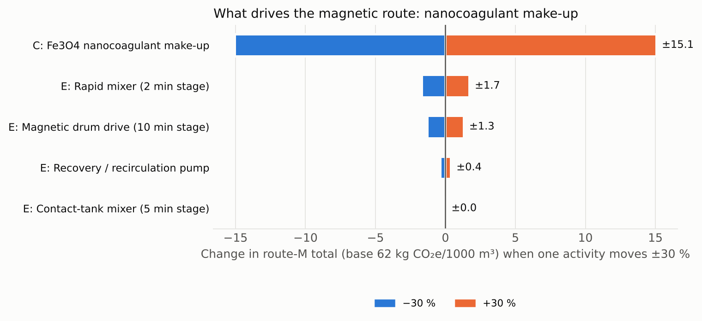
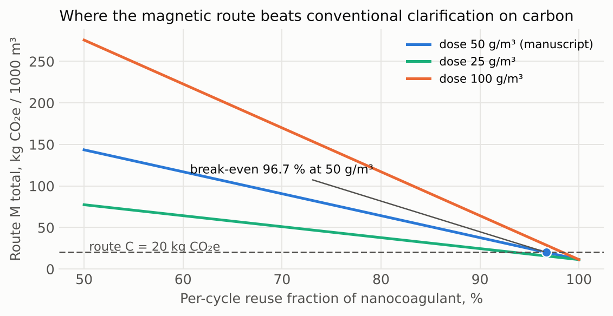

# Case study B — Carbon data audit for a post-precipitation separation stage

The same scenario as Case A, written as an emissions ledger per 1000 m³
treated: magnetic nanocoagulation (route M) against conventional chemical
clarification (route C) for recovering fine CaF₂ after calcium precipitation.

The point of the exercise is not the number. It is the discipline: every
activity datum has a stated basis, every emission factor carries source,
year, region, boundary and a verification status, and anything I could not
verify is reported as a **gap** that makes the total incomplete, rather
than a guess that makes it look finished.

## Layout

| | Path | Purpose |
|---|---|---|
| Factor register | `shared/factors.json` | Single source of truth for factors; read by Python, mirrored in the page |
| Python | `python/carbon_audit.py` | Reference implementation, 19 tests |
| Web | `web/index.html` | Single-file interactive ledger with on-load self-check |

```
cd python
python -m pytest -q
python make_figures.py
python carbon_audit.py     # JSON ledger for the illustrative inputs
```

## Boundary

- Separation stage only. Upstream calcium precipitation (CaCl₂ dosing,
  reaction, ageing) and the CaF₂ sludge mass itself are common to both routes
  and excluded; only route-specific additional solids are counted
  (hydroxide sludge for C, lost nanocoagulant for M).
- **Scope 1 = 0, stated.** A chemical separation stage has no biological
  CH₄/N₂O source (IPCC 2019 Refinement Vol. 5 Ch. 6 covers biological
  treatment). The line is reported with its reason, never omitted.
- Scope 2: electricity, location-based. Scope 3.1: purchased chemicals.
  Scope 3.5: sludge transport and disposal. ISO 14064-1:2018 categories 2 and
  4 respectively.
- Not included: equipment embodied carbon, silica-coating reagents, water
  reuse credits, factor uncertainty ranges. GWP basis follows each source.

## Method

| Quantity | Formula |
|---|---|
| Electricity | kWh = nameplate kW × load factor × running h per 1000 m³ |
| Scope 2 | kWh × grid factor |
| Nanocoagulant make-up | dose (g/m³) × 1000 / 1000 × (1 − reuse fraction) kg |
| Hydroxide sludge | Fe(OH)₃ dry = 0.40 × FeCl₃ product × 106.87/162.20; wet = dry / DS fraction |
| Scope 3.1 | kg chemical × factor |
| Scope 3.5 | t wet × disposal factor + t·km × transport factor |
| Sensitivity | one-at-a-time ±30 % on each activity; linear, so exact |

### Reference nameplates

Plant nameplates were not available, so `reference_equipment()` derives
them with a stated basis rather than a guess:

| Unit | Basis | Result |
|---|---|---|
| Rapid mixer (2 min) | Camp–Stein P = G²μV, G = 600 s⁻¹, V = 1.39 m³, drive η 0.85, next IEC size | 0.75 kW at 0.78 load |
| Contact-tank mixer (5 min) | G = 50 s⁻¹, V = 3.47 m³ | 0.18 kW at 0.06 load |
| Magnetic drum drive (10 min) | Permanent-magnet drum: drive only; vendor brochures reviewed publish no kW | 0.75 kW at 0.6 (reference assumption) |
| Recirculation pump | ρgQH/η, 5 % Q, 10 m, η 0.5 | 0.18 kW at 0.74 load |
| Flocculator (20 min) | G = 50 s⁻¹, V = 13.9 m³ | 0.18 kW at 0.23 load |
| Clarifier scraper (240 min) | Small circular clarifier drive | 0.37 kW at 0.8 (reference assumption) |
| Sludge pump | ρgQH/η, 1 % Q, 10 m | 0.18 kW at 0.15 load |

Feed pumping is common to both routes and excluded. An electromagnet would
add coil power as a separate line.

### Dose and reuse

- Dose 50 g/m³ = the manuscripts' batch dose (50 mg/L).
- Per-cycle reuse 0.81 is derived: Paper B reports 65.9 % of the initial
  inventory entering Cycle 3 after two recoveries; with equal loss per cycle,
  0.659^(1/2) = 0.81. A derivation, not a measured per-cycle recovery.

### Fe₃O₄ factor: bottom-up estimate

No accessible LCA gives kg CO₂e/kg for coprecipitated Fe₃O₄, so
`fe3o4_bottom_up()` builds one from the reaction

    FeCl₂ + 2 FeCl₃ + 8 NaOH → Fe₃O₄ + 8 NaCl + 4 H₂O

| Term | Per kg Fe₃O₄ | Factor | kg CO₂e |
|---|---|---|---|
| FeCl₃ anhydrous | 1.40 kg | INCOPA iron-oxide route 0.395 / 0.40 | 1.38 |
| FeCl₂ anhydrous | 0.55 kg | FeCl₃ per kg Fe as proxy (no FeCl₂ factor found) | 0.69 |
| NaOH, stoichiometric + 20 % | 1.66 kg | Euro Chlor 0.86 | 1.43 |
| Process energy | 4.45 kWh | SG grid 0.401 | 1.79 |
| **Total** | | | **5.29** |

Energy: 20 L process water heated 25→80 °C, 3 kg cake water evaporated per
kg solid, 80 % heat efficiency, 0.5 kWh/kg auxiliaries, all as grid
electricity. Low/high assumption sets (0–50 % NaOH excess, 10–30 L water,
2–4 kg cake water, 0.3–1.0 kWh auxiliaries) give 4.3–6.5. Excludes silica
coating, packaging, transport and brine treatment. The precursor-only floor
(2.07) is kept in the register as a sanity bound.

## Factor register

| Factor | Value | Source | Status |
|---|---|---|---|
| Grid, Singapore 2024 | 0.401 kg CO₂/kWh | EMA, Singapore Energy Statistics, Table T2.3 (revised from 0.402)¹ | verified |
| Grid, Singapore 2025 | 0.404 kg CO₂/kWh | EMA, SES Table T2.3, latest column | verified |
| Grid, China 2022 national | 0.5366 kg CO₂/kWh | 生态环境部、国家统计局公告 2024 年第 33 号 | verified |
| NaOH | 0.86 kg CO₂e/kg | Euro Chlor eco-profile (data 2011, publ. 2013)⁴ | verified |
| FeCl₃ 40 %, iron-oxide route | 0.395 kg CO₂e/kg product | INCOPA LCA of Leading Coagulants (2014) | verified |
| FeCl₃ 40 %, pickling route | 0.135 kg CO₂e/kg product | INCOPA 2014 | verified |
| PAC | 0.537 kg CO₂e/kg product | INCOPA 2014 | verified |
| PAM | 4.76 kg CO₂e/kg | Carbonfact (proprietary) | secondary² |
| Fe₃O₄ nanocoagulant, literature | — | five LCA papers checked, none accessible gives kg CO₂e/kg | **gap** |
| Fe₃O₄ bottom-up estimate | 5.29 (4.3–6.5) kg CO₂e/kg | computed here, see above | estimated |
| Fe₃O₄ precursor lower bound | 2.07 kg CO₂e/kg | derived from INCOPA FeCl₃ by stoichiometry³ | derived floor |
| Sludge disposal | — | DEFRA 2024 full table not opened | **gap** |
| Sludge transport | — | — | **gap** |

¹ Read directly from EMA's `SES_tabular.xlsx`, sheet T2.3, on 2026-11-02
(https://www.ema.gov.sg/content/dam/corporate/resources/singapore-energy-statistics/excel/SES_tabular.xlsx.coredownload.xlsx;
landing page https://www.ema.gov.sg/resources/singapore-energy-statistics/chapter2).
The sheet carries the note "The 2024 GEF has been revised from 0.402 kg
CO₂/kWh to 0.401 kg CO₂/kWh." 2023 = 0.412.
² Commercial database, not peer-reviewed. Replace with ecoinvent or a
supplier EPD.
³ 0.395 kg CO₂e per kg of 13.8 % Fe product = 2.862 kg CO₂e/kg Fe;
Fe₃O₄ is 72.36 % Fe; 2.862 × 0.7236 = 2.07. Iron precursor only; excludes
NaOH, heating, washing, drying, nano-processing and coating. A floor, not an
estimate.
⁴ The eco-profile does not state whether its per-kg figure is 100 % NaOH or
50 % solution; applied per kg NaOH 100 %, which is conservative if the basis
is the solution.

Papers checked for the Fe₃O₄ factor: Arteaga-Díaz et al. 2019 *Appl. Sci.*
9:1682 (reports GWP as "insignificant", no number); Patiño-Ruiz et al. 2021
*ACS Omega* 6:12410 (normalised totals only); Fuentes et al. 2024 *ACS
Sustain. Chem. Eng.* (not accessible); Yunus et al. 2025 *RSC Sustain.*
(results in figure only); PMC9230433 micromixer LCA (not accessible).

## Result with reference inputs

Reference nameplates, dose 50 g/m³, reuse 0.81, Singapore grid 2024, Fe₃O₄ at
the bottom-up estimate, sludge factors set to zero (gap):







What follows is about where the decision sits, not a verdict on the process:

1. Electricity is small for both routes (3.5 and 11 kg CO₂e per 1000 m³),
   and the mixer loads are tiny by Camp–Stein; the drum drive assumption is
   the largest electrical term. The comparison is decided by chemicals.
2. At the manuscript dose and the derived 81 % per-cycle reuse, route M
   (62) is about three times route C (20) on this boundary. Route M reaches
   carbon parity at **≈ 97 % per-cycle reuse at 50 g/m³**, or at a lower
   dose with the same reuse (fig. 3). The number that controls the carbon
   case is therefore recovery efficiency per cycle — the quantity Paper B's
   non-replenished reuse experiments measure — and not energy.
3. The Fe₃O₄ factor (5.3, range 4.3–6.5) moves the break-even by about
   ±1 percentage point; dose and reuse move it far more. A measured LCA value
   would tighten the estimate but would not change where the lever is.

## Input validation

Errors (no result): missing or negative activity, load factor outside 0–1,
reuse fraction outside 0–1, dry-solids fraction outside (0, 1], negative
factor. Warnings: > 240 running hours per 1000 m³, nameplate > 1 MW,
dose > 100 kg/m³ (likely unit errors). Gap factors never default; a verified
factor is never overridden by a user entry.

## AI use

Drafted with AI assistance. Factor lookups were made against the listed
sources and their status recorded as found, including the ones that could
not be opened. The Python tests and the page's self-check share the same
expectations.

## Licence

MIT for the code. Factor values remain under their sources' terms.
